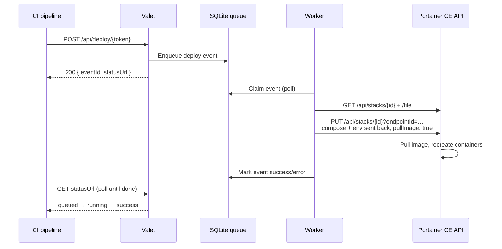

# Valet

**CI-triggered stack redeploys for Portainer Community Edition.**

Push a new image from CI, hit a webhook, and your Portainer stack is pulling and running it within seconds — no manual steps, no Business Edition, no drift.

[](LICENSE)
[](https://nextjs.org)
[](https://www.typescriptlang.org)
[](https://hub.docker.com/r/rdelorenzo/valet)

---

## Why Valet?

Portainer CE has no stack or container webhooks. This means that if you want to re-pull and re-deploy a stack as part of CI, you can't. You have to go into the UI or SSH.

Valet closes that gap. Each stack gets a **deploy hook URL**. When you want to re-deploy your stack, simply POST to that hook and Valet asks Portainer — via its own API — to update the stack with an image re-pull.

The stack will re-deploy and re-pull, using the same compose file and environment variables. Stack environment (`environment`, `env_file`, interpolated values) survives intact, and stacks remain completely normal and editable in the Portainer UI. Nothing acts on Docker behind Portainer's back.

## Features

- **Deploy hooks per stack** — a secret-token URL for each stack you want CI to deploy
- **UI for management** - you can manage users, portainer instances, and webhooks from an easy-to-use web UI.
- **Zero-drift redeploys** — uses Portainer's own API, keeping the stack fully managed by Portainer
- **Webhook degradation alerting** — we check stack reachability in the background, so if something breaks you'll know about it before a deploy failure
- **Multi-instance** — manage several Portainer servers (each with its own access token) with reachability and version checks
- **CI-ready** — copy-paste snippets for GitHub Actions, CircleCI, and other CI providers, generated for your exact hook
- **OIDC login** — multi-provider OpenID Connect with PKCE
- **Super simple to deploy** — valet is a single container, so you don't have to worry about external queues, databases, or caches.

## How it works



## Screenshots

<!-- Drop screenshots into docs/images/ and uncomment. -->

<!-- 

 -->

*Screenshots coming soon — placeholders live in [`docs/images/`](docs/images/).*

## Getting Started

### Prerequisites

- An environment to deploy Valet into, this can be either plain docker + compose or even Portainer itself.

### 1. Deploy

If you're already running Portainer, you can deploy Valet as just another stack on it:

1. In Portainer, go to **Stacks → Add stack** and name it `valet`.
2. You can use this compose definition as a starting point:

   ```yaml
   services:
     valet:
       image: rdelorenzo/valet:latest
       restart: unless-stopped
       ports:
         - "3000:3000"
       environment:
         APP_BASE_URL: https://valet.example.com
         AUTH_SECRET: <your-secret-here>
       volumes:
         - valet-data:/app/data

   volumes:
     valet-data:
   ```
> [!TIP] 
> A ready-made sample lives at [`docker-compose.yml`](docker-compose.yml) in the repo root.

3. Set the environment variables — either inline above, or under the stack's **Environment variables** section (Portainer keeps those with the stack):
   - `APP_BASE_URL` — your public URL, will be used to compute hook and auth URLs
   - `AUTH_SECRET` — generate one with

     ```bash
     openssl rand -base64 32
     ```

4. **Deploy the stack.**

<details>
<summary>Setup for docker compose</summary>

</details>

Notes:

- **TLS** — put a reverse proxy (Caddy, Traefik, nginx) in front of port 3000 and serve Valet over `https://`; `APP_BASE_URL` must match the public URL exactly.
- **Persistence** — the database lives on the `valet-data` volume and is created and migrated automatically on first start. Back up that volume to back up Valet.
- **Reaching Portainer** — Valet talks to Portainer over its API as a client. Deployed on the same host as Portainer, `host.docker.internal` or a shared network works; for self-signed certs (e.g. Portainer's `:9443`), enable the instance's *insecure TLS* option when adding it.

### 2. First-time setup

1. Open the app in a browser. With no login provider configured, it'll send you to the first-time setup flow.
2. Grab the **setup code** from the container logs — it's printed there on first use (in Portainer: **Containers → valet → Logs**, or `docker logs valet`):

   ```text
   ══════════════════════════════════════════
     Valet — Initial setup required
     Setup code: A1B2C3
   ══════════════════════════════════════════
   ```

3. Enter the code (it's valid for one hour) and configure your first **OIDC auth provider**, for example Authentik. The flow will provide you with instructions.
4. Sign in through that provider. **The first account to sign in becomes the admin.**
5. As admin, add your Portainer instances under **Instances**, then create your first deploy hook (below).

## Usage

### Create a deploy hook

From the dashboard, **Create deployment hook** and walk through the wizard:

1. Pick a **Portainer instance** (or add one with the URL + access token)
2. Pick the **stack** to deploy
3. Name the hook

Each hook gets its own secret URL:

```url
https://valet.example.com/api/deploy/<token>
```

### Wire it into CI

Trigger the hook after your image push, then poll until the deploy finishes. We provide snippets to do this in the most popular CI frameworks.

Store the hook URL as a repository secret (e.g. `DEPLOY_WEBHOOK_URL`) rather than committing it.

Building a custom integration? See the [deploy hook API reference](docs/deploy-hook-api.md).

## Development

Run from source:

```bash
git clone https://github.com/rudydelorenzo/valet.git
cd valet
npm ci
npm run dev        # http://localhost:3000
```

| Script | Purpose |
| --- | --- |
| `npm run dev` | Dev server |
| `npm run build` | Production build |
| `npm start` | Serve the production build |
| `npm run lint` | ESLint |
| `npm run typecheck` | Generate route types + TypeScript check |

Notes for contributors:

- Requires **Node.js ≥ 24**.
- Database migrations apply automatically at startup; generated SQL lives in [`drizzle/`](drizzle/).
- The SQLite database is created at `./data/valet.db` on first run (gitignored).

## Contributing

Contributions are welcome.

1. Fork the repository
2. Create your feature branch: `git checkout -b feature/awesome`
3. Commit your changes: `git commit -m 'feat: add awesome'`
4. Push the branch: `git push origin feature/awesome`
5. Open a Pull Request

## Tech Stack

| Layer | Choice |
| --- | --- |
| Framework | [Next.js 16](https://nextjs.org) (App Router) + [React 19](https://react.dev) |
| UI | [Tailwind CSS 4](https://tailwindcss.com) + [shadcn/ui](https://ui.shadcn.com) (Base UI primitives) |
| Database | SQLite via [Drizzle ORM](https://orm.drizzle.team) + `better-sqlite3` (migrations auto-apply at startup) |
| Auth | [OpenID Connect](https://openid.net/developers/how-connect-works/) with PKCE; sessions are signed JWTs ([jose](https://github.com/panva/jose)) |
| Validation | [Zod](https://zod.dev) — the API contract, types inferred from schemas |
| Orchestration | [Portainer CE](https://www.portainer.io) REST API (`X-API-Key` access tokens) |

## License

Distributed under the MIT License. See [LICENSE](LICENSE) for details.

## Acknowledgements

- [Portainer CE](https://www.portainer.io) — whose REST API makes zero-drift redeploys possible
- The research notes in [`docs/`](docs/) tracing the zot → receiver → Portainer path that started this project
- [Next.js](https://nextjs.org), [shadcn/ui](https://ui.shadcn.com), and [Drizzle ORM](https://orm.drizzle.team)
