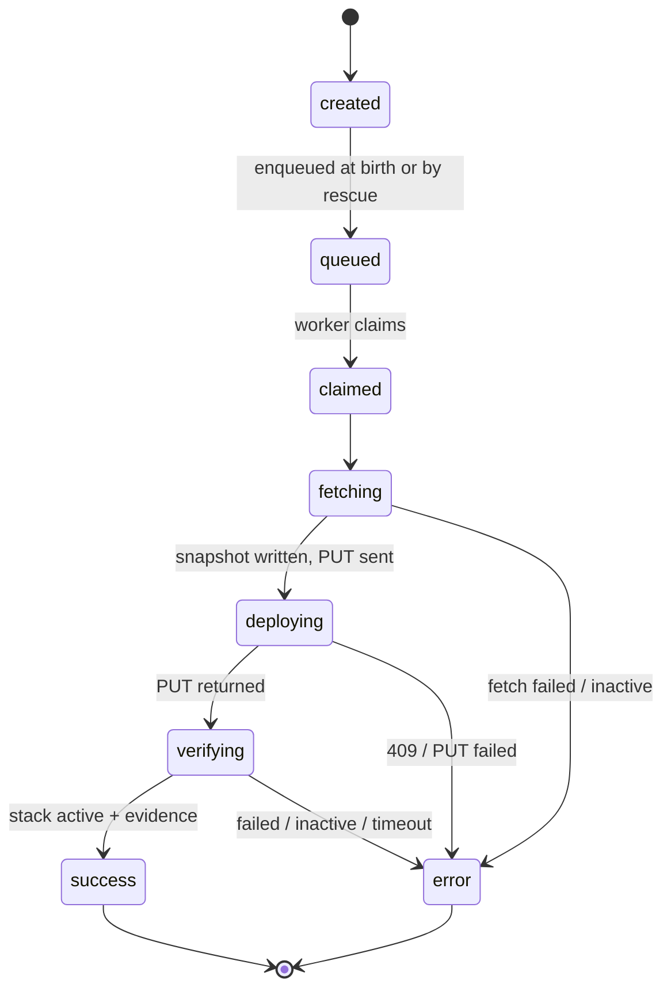

# Deploy job state machine

How a redeploy event moves from webhook call to outcome.

## Why

A redeploy is **not idempotent**: re-running one can pull a newer image than
CI asked for. And the process can die at any instant. So the machine is built
around three rules:

1. **Progress is persisted.** Every transition is an append-only log row
   (`webhook_event_steps`), so a restarted process resumes exactly where the
   old one died.
2. **One PUT per event.** The `deploying` row — with an evidence snapshot —
   is written *before* the PUT is sent. Anything past that line is recovered
   by observing Portainer, never by re-sending.
3. **Every event resolves.** A per-webhook timeout (measured from claim, not
   from the webhook call) guarantees a terminal answer.

## How — the state machine

`queued` is the pickable marker: **only events at the `queued` step are
claimed.** Any event interrupted mid-flight is re-enqueued at boot (an
appended `queued` row) and **skips ahead to its furthest work step** —
fresh and recovered events run the same code. Terminal rows carry the
outcome message (`success`/`error` double as step values).

## The steps

### `created` — the event exists

Written together with the event row and its `queued` row (one transaction)
— the log opens with birth and pickability.

### `queued` — pickable

Marks the event as ready for a worker. Written at birth, and re-appended by
boot recovery when it re-enqueues orphaned events. The log then tells the
recovery story: `created → claimed → … → queued → claimed → …`.

### `claimed` — processing starts

The worker (or the UI trigger) atomically appends the `claimed` row — the
guarded append *is* the claim, so only one claimer can win. **The timeout
window starts at the first claim**. This means queue
wait doesn't count (the time between creating the event and the worker picking it up), 
and a crash-requeue cycle doesn't buy extra time.

### `fetching` — read-only preparation

Fetch the stack and its compose file; refuse inactive stacks (a deploy would
activate them). Nothing has been sent to Portainer, so this step is safe to
redo after a crash.

### `deploying` — the point of no return

Snapshots the stack's `UpdateDate` and its containers' `{id, created,
imageId}` into the log row, **then** sends the PUT (`PullImage` +
`RepullImageAndRedeploy`, env preserved). 

A 2xx response is deliberately not proof: its `Status` field is ignored,
and the outcome is assessed in `verifying` like every other path — keeping
the machine version-agnostic. A non-2xx fails immediately with a specific
message (409 = deploy already in progress).

Why the snapshot? We want to check if a re-deploy has actually taken place, 
even if we sent the PUT (thus triggering the redeploy) but then the process 
died or was killed. The clearest scenario here is if we use a webhook to 
re-deploy valet *itself*. The PUT is sent, which starts the redeploy and 
kills valet itself. When valet comes back online, it can pick up the event. 
The most reliable way to check if the redeploy actually happened is to check 
container uptime. However, we don't want to compare our current time with the 
`createdAt` field on the docker since that could have issues. We instead 
track the date from docker itself.

Portainer 2.41 changed the way that deploys work. Now calling the redeploy 
endpoint is asynchronous, and then you can check on the progress of the redploy 
by checking the stack status. To aid you in this new workflow, this update 
also introduced the DeploymentStatus field to the Portainer API. 
This change actually better aligns with our concept of how deployments work. You 
can [read more here](https://docs.portainer.io/portainer-documentation/sts/faqs/troubleshooting/stacks-deployments-and-updates/why-did-my-api-client-start-getting-409-errors-after-upgrading).

### `verifying` — observe to the end

Poll the stack every 5s until it resolves. Post-2.41 versions will move to 
this step immediately after sending the redeploy PUT, since the deploy is async. 
Older versions will only progress to this step when the redeploy PUT request finishes, 
usually either because the deploy succeeded or failed. Regardless, the success or failure of the 
redeploy is always assessed here. Redeploy-success is decided by an
evidence ladder: 
* deployment journal (aka `DeploymentStatus`, only present after 2.41), 
* container recreation, 
* `UpdateDate` bump — so a redeploy that landed while we were dead is still reported as a success. 

Outcomes: 
* stack active + evidence → `success`;
* stack active + no evidence → keep watching (see below);
* error status on `DeploymentStatus` (Portainer >= 2.41 only) → `error` with Portainer's own message; 
* stack inactive → `error`;
* deadline → `error` ("could not confirm").

**Stack active but no evidence** — For example, we PUT to Portainer pre-2.41 (synchronous redeploy). Valet dies 
mid-request and Portainer returns a 4xx we never see, on a stack that was already `active`. When valet 
resumes and picks up the stranded event it keeps watching, and if no evidence ever appears 
the deadline fires and the event ends in `error` ("could not confirm") — 
it can never resolve to `success`, which always requires evidence. 
We deliberately do not error early here: on pre-2.41 Portainer a deploy still running 
server-side is indistinguishable from one that died, and its evidence only appears 
when it actually finishes (slow pulls!). The per-webhook `deploy_timeout_seconds`
is the patience knob — how long to keep watching before declaring failure.

This closely mirrors [Portainer's own guidance](https://docs.portainer.io/portainer-documentation/sts/faqs/troubleshooting/stacks-deployments-and-updates/why-did-my-api-client-start-getting-409-errors-after-upgrading#how-should-my-ci-cd-pipeline-check-if-a-deployment-succeeded) 
for checking deployment success, while retaining compatibility for pre-2.41 versions.

### `success` / `error` — terminal

`finishEvent` appends the terminal row carrying the outcome message. The
lifecycle status shown on the wire (`queued`/`running`/`success`/`error`)
is **derived from this log** — state lives in exactly one place.

## Code map

| Piece | Where |
| --- | --- |
| Executor (fetch/PUT/watch) | `src/lib/worker/jobs/deploy/index.ts` |
| Pure decisions + invariants | `src/lib/worker/jobs/deploy/state.ts` |
| Log writes / reads | `src/lib/db/webhook-event-steps.ts` (pure accessors); `src/lib/webhook-events.ts` (lifecycle rules: enqueue, claim, finish, recovery) |
| State vocabulary | `src/lib/constants.ts` (`DEPLOY_STEP`, `TERMINAL_STATE`, …) |
